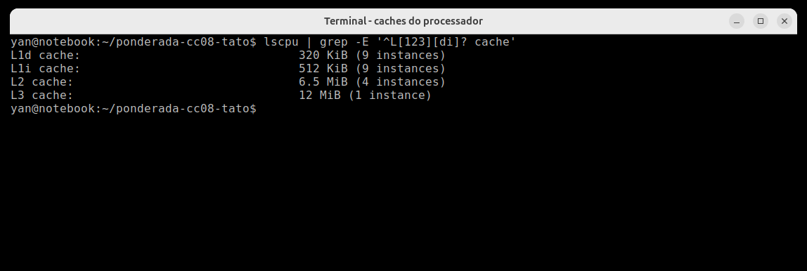
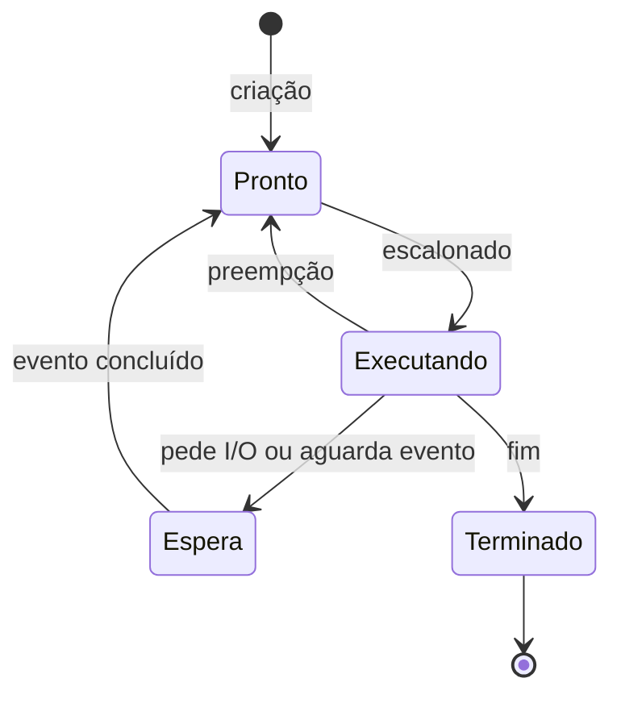
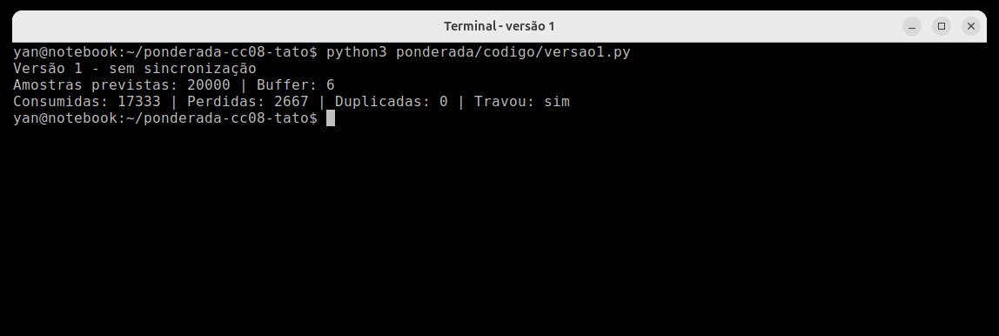
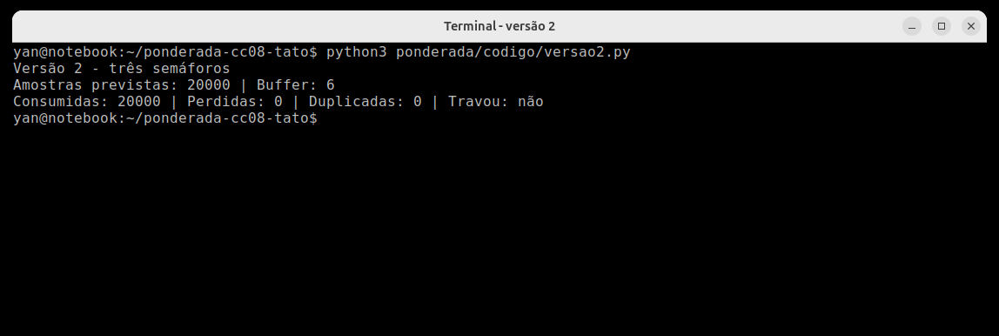
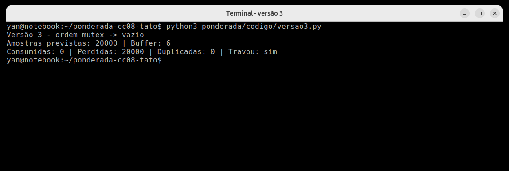
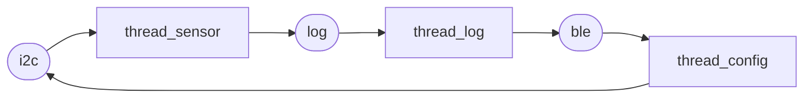

**Yan Dimitri Kruziski - D1 = 3, D2 = 8 e N = 6.**

# Parte A - O problema técnico

## A1. Arquitetura e memória

Meus parâmetros são:

$$
IC = 100.000 + 20.000 \times 8 = 260.000\ \text{instruções}
$$

$$
m = 3\% + 0,5\% \times 3 = 4,5\% = 0,045
$$

### 1. Plataforma H

O tempo de processamento é:

$$
T_H = \frac{IC \times CPI}{f} = \frac{260.000 \times 1,5}{48 \times 10^6}
= 0,008125\ s = 8,125\ ms
$$

Portanto, a Plataforma H sem acelerador **não atende** ao limite de 5 ms. Ela passa 3,125 ms do prazo.

### 2. Plataforma V

O tempo médio de acesso à memória é:

$$
AMAT = 1 + (m \times 120) = 1 + (0,045 \times 120) = 6,4\ \text{ciclos}
$$

O CPI efetivo considera os 1,3 acessos à memória por instrução:

$$
CPI_{efetivo} = 1 + (1,3 \times 0,045 \times 120) = 1 + 7,02 = 8,02
$$

Assim, o tempo de processamento é:

$$
T_V = \frac{260.000 \times 8,02}{1,2 \times 10^9}
= 0,0017377\ s \approx 1,738\ ms
$$

No pior caso, o Linux interrompe a tarefa por 3 ms:

$$
T_{V,pior} = 1,738 + 3 = 4,738\ ms
$$

A Plataforma V **atende** ao requisito, mas com uma folga pequena de aproximadamente 0,262 ms no pior caso.

### 3. Plataforma H com DSP

O filtro ocupa 60% do tempo e é acelerado cinco vezes. Pela Lei de Amdahl:

$$
Speedup = \frac{1}{(1-0,6)+\frac{0,6}{5}}
= \frac{1}{0,52} \approx 1,923
$$

$$
T_{H,DSP} = \frac{8,125}{1,923} = 4,225\ ms
$$

Com o DSP, a Plataforma H **passa a atender** ao requisito, com 0,775 ms de folga.

### 4. Por que a V precisa de cache e a H não?

Na arquitetura Von Neumann da V, instruções e dados disputam o mesmo caminho até uma DRAM bem mais lenta que o processador, formando o gargalo de Von Neumann. A cache mantém os acessos mais frequentes perto da CPU e reduz essa diferença de velocidade. Já a H separa instruções e dados e usa SRAM interna de um ciclo, então não depende de cache para acompanhar o processador.

### 5. Evidência da minha máquina



Minha L1 é dividida: há 320 KiB de L1d e 512 KiB de L1i, distribuídos pelos núcleos. O computador continua tendo um espaço de endereçamento unificado, característica de Von Neumann, mas a organização da L1 separa instruções e dados. Por isso, a descrição mais precisa é **Von Neumann com cache Harvard modificada**, e não Harvard pura.

## A2. Pipeline do filtro

Para encurtar os diagramas, usei `I1` até `I7` conforme a numeração do enunciado. `ID*` e `IF*` indicam um estágio parado por uma bolha.

### 1. Dependências RAW

| Consumidora | Produtora | Registrador | Motivo |
|---|---|---|---|
| I2 (`add`) | I1 (`lw`) | `x5` | A soma usa a amostra recém-carregada. |
| I4 (`sub`) | I2 (`add`) | `x6` | A subtração usa a soma atualizada. |
| I4 (`sub`) | I3 (`lw`) | `x7` | A subtração usa a amostra antiga recém-carregada. |
| I5 (`sw`) | I4 (`sub`) | `x6` | O armazenamento grava a soma final. |

### 2. Sem forwarding

Como o registrador é escrito na primeira metade do ciclo e lido na segunda, uma instrução em `ID` já pode ler o valor que a produtora escreve em `WB` no mesmo ciclo.

| Instrução | 1 | 2 | 3 | 4 | 5 | 6 | 7 | 8 | 9 | 10 | 11 | 12 | 13 | 14 | 15 | 16 | 17 |
|---|---|---|---|---|---|---|---|---|---|---|---|---|---|---|---|---|---|
| I1 | IF | ID | EX | MEM | WB | | | | | | | | | | | | |
| I2 | | IF | ID | ID* | ID* | EX | MEM | WB | | | | | | | | | |
| I3 | | | IF | IF* | IF* | ID | EX | MEM | WB | | | | | | | | |
| I4 | | | | | | IF | ID | ID* | ID* | EX | MEM | WB | | | | | |
| I5 | | | | | | | IF | IF* | IF* | ID | ID* | ID* | EX | MEM | WB | | |
| I6 | | | | | | | | | | IF | IF* | IF* | ID | EX | MEM | WB | |
| I7 | | | | | | | | | | | | | IF | ID | EX | MEM | WB |

O trecho leva **17 ciclos**, do primeiro `IF` ao último `WB`.

### 3. Com forwarding

| Instrução | 1 | 2 | 3 | 4 | 5 | 6 | 7 | 8 | 9 | 10 | 11 | 12 | 13 |
|---|---|---|---|---|---|---|---|---|---|---|---|---|---|
| I1 | IF | ID | EX | MEM | WB | | | | | | | | |
| I2 | | IF | ID | ID* | EX | MEM | WB | | | | | | |
| I3 | | | IF | IF* | ID | EX | MEM | WB | | | | | |
| I4 | | | | | IF | ID | ID* | EX | MEM | WB | | | |
| I5 | | | | | | IF | IF* | ID | EX | MEM | WB | | |
| I6 | | | | | | | | IF | ID | EX | MEM | WB | |
| I7 | | | | | | | | | IF | ID | EX | MEM | WB |

O total cai para **13 ciclos**. As dependências `I1 → I2` em `x5` e `I3 → I4` em `x7` ainda provocam uma bolha cada. Ambas são do tipo *load-use*: o dado do `lw` só fica disponível no fim de `MEM`, tarde demais para o `EX` da instrução imediatamente seguinte.

### 4. Reordenação

Uma ordem sem bolhas, preservando o resultado, é:

```asm
lw   x5, 0(x10)       # I1: lê a nova
lw   x7, 0(x11)       # I3: lê a antiga
addi x10, x10, 4      # I6: avança o ponteiro da nova
add  x6, x6, x5       # I2: soma += nova
sub  x6, x6, x7       # I4: soma -= antiga
sw   x6, 0(x12)       # I5: grava a soma
addi x11, x11, 4      # I7: avança o ponteiro da antiga
```

| Instrução reordenada | 1 | 2 | 3 | 4 | 5 | 6 | 7 | 8 | 9 | 10 | 11 |
|---|---|---|---|---|---|---|---|---|---|---|---|
| I1 | IF | ID | EX | MEM | WB | | | | | | |
| I3 | | IF | ID | EX | MEM | WB | | | | | |
| I6 | | | IF | ID | EX | MEM | WB | | | | |
| I2 | | | | IF | ID | EX | MEM | WB | | | |
| I4 | | | | | IF | ID | EX | MEM | WB | | |
| I5 | | | | | | IF | ID | EX | MEM | WB | |
| I7 | | | | | | | IF | ID | EX | MEM | WB |

O trecho passa a levar **11 ciclos**, que é o mínimo para sete instruções em um pipeline de cinco estágios sem bolhas.

## A3. Processos e threads

### 1. Organização proposta

Eu colocaria leitura do sensor, processamento e controle do motor como três threads de um mesmo processo principal. Elas formam o caminho crítico, trocam cada amostra pelo mesmo buffer e se beneficiam da memória compartilhada e da troca de contexto mais leve. A criação também é mais barata, embora neste produto esse custo aconteça principalmente na inicialização.

O BLE ficaria em um processo separado e com privilégios mínimos. Ele receberia os logs e enviaria comandos ao processo principal por IPC, com mensagens pequenas e validadas. Há um custo extra de cópia, criação e troca de contexto, mas ele fica fora do caminho sensor-processamento-motor e compra isolamento para a parte que recebe dados externos.

### 2. Efeito de uma falha no BLE

Como thread, o BLE enxerga a mesma memória das tarefas críticas. Uma exploração poderia alterar o buffer, mudar comandos do motor ou derrubar o processo inteiro. Como processo separado, ele fica em outro espaço de endereçamento: uma falha tende a derrubar apenas a comunicação, e o sistema principal pode reiniciá-lo. O IPC ainda precisa validar tamanho e conteúdo das mensagens, mas reduz bastante o alcance do ataque.

### 3. Estados de um processo



A thread do sensor passa a maior parte do tempo em **espera (bloqueada)**, aguardando o próximo período de 10 ms ou a conclusão da leitura. Ela acorda, faz uma tarefa curta e volta a esperar; não faz sentido ocupar a CPU durante todo o intervalo.

## A4. Buffer com semáforos

As três versões estão em [`codigo`](codigo). Rodei cada uma três vezes com 20.000 amostras e `N = 6`.

| Versão | Execução | Consumidas | Perdidas | Duplicadas | Travou? |
|---|---:|---:|---:|---:|---|
| 1 - sem sincronização | 1 | 17.672 | 2.328 | 0 | Sim |
| 1 - sem sincronização | 2 | 17.619 | 2.381 | 0 | Sim |
| 1 - sem sincronização | 3 | 17.327 | 2.673 | 0 | Sim |
| 2 - semáforos | 1 | 20.000 | 0 | 0 | Não |
| 2 - semáforos | 2 | 20.000 | 0 | 0 | Não |
| 2 - semáforos | 3 | 20.000 | 0 | 0 | Não |
| 3 - ordem trocada | 1 | 0 | 20.000 | 0 | Sim |
| 3 - ordem trocada | 2 | 0 | 20.000 | 0 | Sim |
| 3 - ordem trocada | 3 | 0 | 20.000 | 0 | Sim |

### Prints das execuções







### Análise

Na versão 1, a região crítica inclui a consulta e atualização de `ocupadas`, junto com o acesso ao buffer e o avanço dos índices. O `sleep(0)` entre ler e escrever o contador permite que as duas threads leiam o mesmo valor e depois sobrescrevam a atualização uma da outra. O contador deixa de representar o buffer real; daí surgem posições sobrescritas, amostras perdidas e, dependendo do escalonamento, leituras repetidas. Nestas três execuções apareceram perdas, mas não duplicações.

Na versão 2, `vazio` começa em 6 e impede o produtor de escrever quando o buffer está cheio. `cheio` começa em 0 e impede o consumidor de ler uma posição ainda vazia. `mutex`, iniciado em 1, garante exclusão mútua durante o acesso ao buffer e aos índices. A ordem é importante: primeiro se espera uma vaga ou um item e só depois se entra na região crítica.

Na versão 3, o produtor enche as seis posições e tenta produzir a sétima. Ele segura `mutex` enquanto espera `vazio`; o consumidor já tem um item sinalizado por `cheio`, mas não consegue entrar porque precisa do mesmo `mutex`. Um espera o outro e nenhum libera o recurso. O watchdog de um segundo detecta essa situação, por isso as três execuções foram registradas como travamento.

## A5. Deadlock

### 1. Sequência e grafo de alocação

Uma sequência possível é:

1. `thread_sensor` executa `P(i2c)` e fica com o barramento.
2. `thread_log` executa `P(log)` e fica com o arquivo.
3. `thread_config` executa `P(ble)` e fica com o rádio.
4. O sensor pede `log`, que está com a thread de log.
5. A thread de log pede `ble`, que está com a configuração.
6. A configuração pede `i2c`, que está com o sensor. O ciclo fechou.

No grafo, recurso apontando para thread significa alocação; thread apontando para recurso significa solicitação pendente.



### 2. As quatro condições necessárias

- **Exclusão mútua:** cada semáforo dá acesso exclusivo ao I2C, log ou BLE.
- **Posse e espera:** cada thread segura um recurso enquanto pede o segundo.
- **Sem preempção:** um recurso não é retirado à força; apenas a dona chama `V`.
- **Espera circular:** sensor espera log, log espera BLE e configuração espera I2C, que está com o sensor.

### 3. Duas correções

**Prevenção por ordem global.** Eu definiria a ordem `i2c → log → ble` para todas as threads. A `thread_config` passaria a adquirir `i2c` antes de `ble`, quebrando a espera circular. Para quem usa a pulseira, isso elimina esse congelamento, mas um comando de configuração pode esperar um pouco mais enquanto o sensor termina sua leitura. O caminho crítico do sensor continua curto.

**Detecção e recuperação.** Além da ordem global, em uma estratégia alternativa eu usaria esperas com tempo limite e um supervisor. Ao detectar o ciclo, o sistema abortaria a operação de menor prioridade, liberaria seus recursos e reiniciaria apenas o processo BLE/configuração; a leitura sensorial não seria reiniciada. A pessoa poderia notar um comando ou log sendo reenviado, mas não ficaria sem a vibração de obstáculos. Essa opção aceita a possibilidade do deadlock e exige que a liberação de recursos seja testada com cuidado.

# Parte B - Memorando ao conselho da Tato

**Decisão: vou colocar a Plataforma H com DSP na produção.**

A conta que mais pesou foi o pior caso. Sem o DSP, a H leva 8,125 ms e não serve para a pulseira. Com o acelerador, a Lei de Amdahl dá um ganho global de 1,923 vezes e o tempo cai para 4,225 ms. A Plataforma V também atende, mas chega a 4,738 ms quando entra o atraso de 3 ms do Linux. As duas passam, porém a H com DSP tem mais folga e não depende do escalonador de um sistema operacional de propósito geral no caminho entre o sensor e o motor.

Essa escolha custa R$ 37 por unidade, contra R$ 70 da V. Em 2.000 pulseiras, são R$ 66 mil a menos, dinheiro que pode ir para testes, estoque de reposição e suporte. Também reduz a superfície de ataque por não carregar Linux e serviços de rede desnecessários.

O que eu estou abrindo mão é da atualização pela internet. Se aparecer um defeito de firmware, a pessoa terá de levar ou enviar a pulseira à assistência para a atualização por cabo. Esse custo não fica só com a empresa: o usuário perde tempo e pode ficar temporariamente sem um recurso de mobilidade. Por isso, eu condicionaria o lançamento a testes de estresse do prazo de 5 ms e manteria unidades de troca rápida na assistência.

Eu mudaria para a Plataforma V se os testes de campo mostrassem que mais de 1% das pulseiras por trimestre precisa de atualização de firmware, ou se uma atualização crítica de segurança não pudesse ser resolvida por troca rápida em até 48 horas. Nesse cenário, a capacidade de corrigir remotamente passaria a valer mais do que a economia e a previsibilidade atuais da H com DSP.
